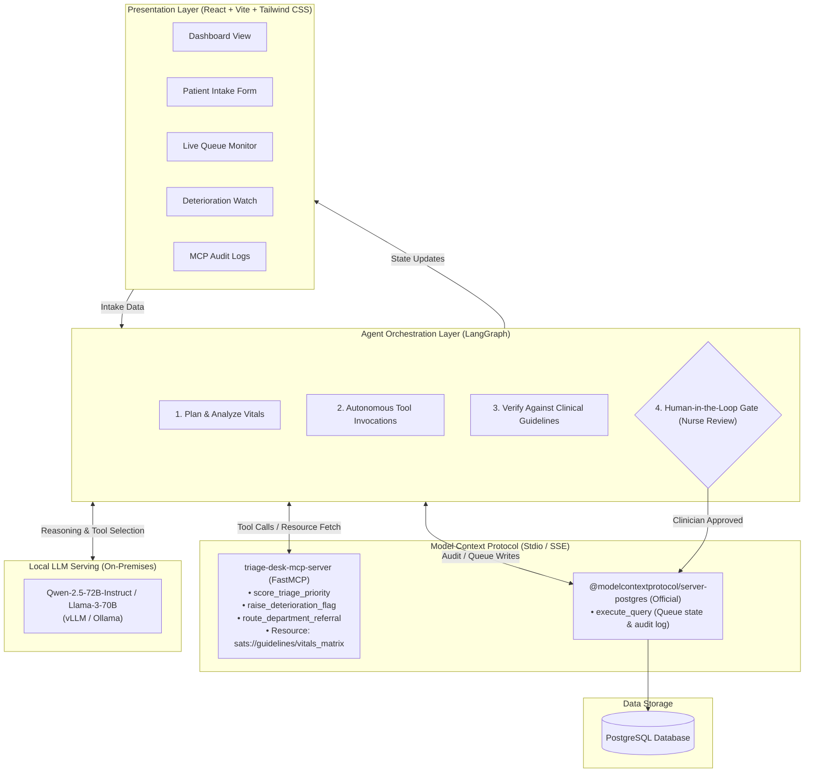

# TriageDesk — Agentic AI for Hospital Triage

> **Agentic AI decision-support system converting patient vitals and chief complaints into standardized, cited South African Triage Scale (SATS) urgency levels in seconds.**  
> Built with LangGraph, Model Context Protocol (MCP), FastMCP, PostgreSQL, and Open-Weights LLMs.

[](https://vitejs.dev/)
[](https://react.dev/)
[](https://www.typescriptlang.org/)
[](https://modelcontextprotocol.io/)
[](https://tailwindcss.com/)
[](https://opensource.org/licenses/MIT)

---

## Table of Contents
1. [Problem Statement](#1-problem-statement)
2. [Solution Overview](#2-solution-overview)
3. [Target Users](#3-target-users)
4. [System Architecture](#4-system-architecture)
5. [Setup & Installation Instructions](#5-setup--installation-instructions)
6. [Usage Instructions](#6-usage-instructions)
7. [Technology Stack](#7-technology-stack)
8. [Agent Architecture](#8-agent-architecture)
9. [MCP Implementation](#9-mcp-implementation)
10. [MCP Tools & Servers](#10-mcp-tools--servers)
11. [Human-in-the-Loop (HITL) Workflow](#11-human-in-the-loop-hitl-workflow)
12. [Limitations](#12-limitations)
13. [Future Improvements](#13-future-improvements)

---

## 1. Problem Statement

Emergency Departments (EDs) worldwide face severe crowding and staffing shortages:
- **Prolonged Wait Times:** Patients routinely wait 60–90+ minutes before initial clinical triage assessment.
- **Silent Waiting-Room Deterioration:** Patients whose conditions worsen while waiting in crowded waiting areas are often detected too late.
- **Cognitive Overload & Triage Variability:** Overwhelmed triage nurses must make high-stakes urgency classifications under extreme cognitive load, resulting in inconsistent triage priority assignments across shifts and staff experience levels.
- **Data Sovereignty & Privacy Concerns:** Strict healthcare privacy regulations (HIPAA, GDPR, POPIA) and hospital network policies prohibit transmitting Protected Health Information (PHI) to commercial, closed-source cloud LLMs.

---

## 2. Solution Overview

**TriageDesk** is an agentic clinical decision-support system that accelerates, standardizes, and safeguards emergency department triage:
- **Instant Urgency Scoring:** Ingests objective physiological vitals and subjective chief complaints to compute a standardized South African Triage Scale (SATS) score in **under 10 seconds**.
- **Evidence-Grounded Citations:** Every recommended triage priority is explicitly grounded in specific clinical discriminators and cited SATS reference guidelines.
- **Local Open-Weights Execution:** Designed to interface with open-weights LLMs (Qwen-2.5-72B / Llama-3-70B) served locally via vLLM or Ollama, guaranteeing 100% data sovereignty with zero PHI cloud transmission.
- **Continuous Deterioration Monitoring:** Tracks patient vitals over time to detect physiological deterioration deltas and raise high-priority nurse alerts.
- **Human-in-the-Loop Safety Gate:** The AI acts strictly as decision support—no queue changes or status updates occur without explicit clinician sign-off.

---

## 3. Target Users

| User Persona | Role & Needs | How TriageDesk Helps |
| :--- | :--- | :--- |
| **ED Triage Nurses** | Frontline intake clinicians assessing 50–150 patients per shift | Reduces cognitive burden; computes composite SATS scores and flags discriminators in seconds. |
| **ED Charge Nurses & Supervisors** | Oversee department-wide flow, bed assignments, and waiting times | Real-time queue view, priority distribution, and immediate alerts for deteriorating patients. |
| **Emergency Physicians** | Treat admitted patients based on clinical priority | Receives standardized, auditable intake summaries with clear physiological justifications. |
| **Hospital IT & Compliance Officers** | Ensure patient data privacy and regulatory compliance | Air-gapped on-premises architecture, local LLM serving, and an immutable PostgreSQL audit trail. |

---

## 4. System Architecture



---

## 5. Setup / Installation Instructions

### Prerequisites
- **Node.js**: v18.0.0 or higher
- **npm**: v9.0.0 or higher
- **Git**

*(Optional for full on-premises backend deployment):*
- **Python**: 3.11+
- **PostgreSQL**: 15+
- **vLLM** or **Ollama** (for local open-weights LLM inference)

### 1. Clone the Repository
```bash
git clone https://github.com/Kamoing98/Hospital-Triage.git
cd Hospital-Triage
```

### 2. Install Dependencies
```bash
npm install
```

### 3. Run Development Server
```bash
npm run dev
```
The application will launch locally at: **`http://localhost:3000`**

### 4. Build for Production
```bash
npm run build
```

### 5. Typecheck
```bash
npm run typecheck
```

---

## 6. Usage Instructions

1. **Dashboard Overview (`Dashboard` Tab)**:
   - Inspect real-time emergency department metrics: total patients in queue, nurse-approved count, average wait times, and SATS priority breakdown (Red, Orange, Yellow, Green).
2. **Patient Intake (`New Patient` Tab)**:
   - Enter patient demographic information (Name, Age, Gender).
   - Enter baseline vitals: Blood Pressure (Systolic/Diastolic), Heart Rate, Respiratory Rate, Oxygen Saturation ($SpO_2$), Temperature, and AVPU consciousness level.
   - Enter the chief complaint, symptom duration, and additional clinical tags.
3. **Execute AI Triage Assessment**:
   - Click **Run Agent Triage**.
   - Watch the multi-step agent workflow execute: tool discovery, SATS matrix cross-referencing, department routing, and guideline citation.
4. **Nurse Review & Human Gate**:
   - Review the AI's recommended SATS score, priority color, and cited discriminator.
   - Click **Confirm & Add to Queue** to approve, or adjust if clinical discretion indicates an override.
5. **Deterioration Watch (`Deterioration` Tab)**:
   - Monitor waiting patients whose repeat vitals cross critical delta thresholds.
   - Review automated deterioration flags and escalate care immediately.
6. **Agent Audit Logs (`Agent Logs` Tab)**:
   - Review immutable records of every MCP tool invocation, payload, execution time, and approving clinician ID.

---

## 7. Technology Stack

| Layer | Technologies | Purpose |
| :--- | :--- | :--- |
| **Frontend Framework** | React 18, TypeScript 5, Vite 6 | High-performance, responsive clinical user interface |
| **Styling & UI Components** | Tailwind CSS 4, Lucide React, Framer Motion | Modern clinical design system with responsive animations |
| **Data Visualization** | Recharts | Visual priority distribution and vital trend tracking |
| **Agent Orchestration** | LangGraph, Pydantic AI | Stateful agent execution graph with conditional branching & loops |
| **Model Context Protocol** | FastMCP Python SDK, MCP TypeScript SDK | Standardized interface for tool execution and resource retrieval |
| **Local LLM Serving** | vLLM / Ollama | Low-latency, privacy-preserving on-premise model inference |
| **Models** | Qwen-2.5-72B-Instruct, Llama-3-70B-Instruct | High-reasoning open-weights clinical decision support |
| **Database & Auditing** | PostgreSQL (Official MCP Postgres server) | ACID-compliant queue management and immutable audit trails |
| **Deployment** | Vercel (Frontend), Docker (Local Services) | Cloud demo deployment and reproducible container environments |

---

## 8. Agent Architecture

TriageDesk does not use a simplistic single-turn chat prompt. It operates as a **stateful LangGraph state machine**:

```
START 
  ↓
[intake_vitals] 
  ↓
[tool_selection] 
  ↓
score_triage_priority (FastMCP Server)
  ↓
verify_against_sats (Cross-reference sats://guidelines/vitals_matrix)
  ↓
route_department_referral (Determine target ED unit)
  ↓
⏸ [HUMAN_GATE] ─── (Awaiting Named Clinician Approval) ───┐
  ↓ (Approved)                                            ↓ (Rejected / Override)
execute_query (PostgreSQL MCP Server)             adjust_discriminators
  ↓                                                       ↓
[queue_update & audit_commit]                            retry (max 2)
  ↓
END
```

### Self-Correction & Deterministic Guardrails
- **Autonomous Tool Selection:** The agent dynamically decides tool payloads based on incoming patient data.
- **Verification Loop:** Every computed priority is cross-checked against the official SATS matrix resource. If a discrepancy exists, the agent self-corrects or flags the case for manual clinician review.
- **No Unsupervised State Commits:** The agent cannot alter queue positions without passing through the human gate.

---

## 9. MCP Implementation

The **Model Context Protocol (MCP)** provides the standardized abstraction layer connecting the LangGraph triage agent to tools, external services, and reference guidelines:

- **Protocol Separation:** Completely decouples model reasoning from backend implementation details, allowing models or databases to be swapped without changing business logic.
- **Stdio Transport:** High-speed Inter-Process Communication (IPC) for local tools.
- **SSE Transport:** Server-Sent Events transport for modular networked services.
- **Dynamic Tool Discovery:** Tools and reference resources are exposed and introspected dynamically at runtime via standard JSON-RPC 2.0 schemas.

---

## 10. MCP Tools & Servers

### Custom Server: `triage-desk-mcp-server` (Built with FastMCP)
| Tool / Resource | Type | Description |
| :--- | :--- | :--- |
| `score_triage_priority` | Tool | Computes composite SATS score from vitals + complaints and returns priority level (`red`, `orange`, `yellow`, `green`) with guideline citation. |
| `raise_deterioration_flag` | Tool | Compares baseline vitals to reassessment vitals; calculates physiological deltas and raises alert flags if thresholds are breached. |
| `route_department_referral` | Tool | Maps patient priority, age, and clinical complaints to appropriate hospital wings (Resuscitation, Acute Care, Urgent Care, Outpatient). |
| `sats://guidelines/vitals_matrix` | Resource | Static reference resource containing SATS vital sign discriminators for deterministic in-context LLM verification. |

### Borrowed Server: `@modelcontextprotocol/server-postgres` (Official)
| Tool | Type | Description |
| :--- | :--- | :--- |
| `execute_query` | Tool | Executes parameterized SQL queries for persistent queue management and creates immutable audit log entries. |

> **Why Borrowed Over Custom?** Reusing the battle-tested official Postgres MCP server guarantees enterprise-grade connection pooling, query sanitization, and schema introspection without writing redundant database CRUD boilerplate.

---

## 11. Human-in-the-Loop (HITL) Workflow

Patient safety is the fundamental design constraint of TriageDesk:

```
[Agent Assessment Complete]
           │
           ▼
┌──────────────────────────────────────────────┐
│       MANDATORY NURSE GATE (Modal/UI)        │
│                                              │
│ • Suggested SATS: Orange (Score: 2)          │
│ • Discriminator: Severe Chest Pain           │
│ • Citation: SATS Table 2.1                   │
│ • Target Assessment: <10 minutes             │
│                                              │
│ [ Approve Priority ]   [ Clinician Override ]│
└──────────────────────────────────────────────┘
           │                        │
     (Clinician Signs)      (Reason Documented)
           │                        │
           ▼                        ▼
┌──────────────────────────────────────────────┐
│ PostgreSQL Immutable Audit Trail             │
│ • Patient ID: P007                           │
│ • Clinician ID: Nurse Fatima B.              │
│ • Timestamp: 2026-10-15T09:14:22Z            │
│ • Action: Confirmed / Added to Queue         │
└──────────────────────────────────────────────┘
```

### Safety Non-Negotiables:
1. **Never Diagnoses:** TriageDesk scores urgency level only; it never produces a clinical diagnosis.
2. **Never Prescribes:** Does not recommend medications, dosages, or treatments.
3. **Never Moves a Patient Unattended:** The graph execution halts at the gate until an authenticated clinician approves or overrides.
4. **Deterioration Alerts are Flags, Not Verdicts:** Alerts signal the need for immediate physical re-examination; they do not manipulate the queue silently.
5. **Survives Clinical Audits:** Every tool call, model input/output, and nurse confirmation is immutably logged to PostgreSQL.

---

## 12. Limitations

- **Prototype Validation with Synthetic Data:** Currently validated on comprehensive synthetic clinical cohorts; formal clinical trials and institutional IRB approval are required prior to live clinical deployment.
- **Adult SATS Focus:** Current discriminator tables emphasize adult emergency admissions. Specialized pediatric and obstetric matrices require further validation.
- **Local Compute Requirements:** Running 70B parameter open-weights models locally requires enterprise GPU hardware (e.g., NVIDIA A100/H100 or dual RTX 4090s with quantization).
- **Standalone Mode:** Currently operates as an independent decision-support interface; direct bi-directional integration requires hospital-specific EHR bridges.

---

## 13. Future Improvements

- [ ] **HL7 / FHIR MCP Server:** Native integration to stream real-time telemetry directly from hospital bedside monitors (Philips, Mindray, GE Health).
- [ ] **Multimodal Voice Intake:** Speech-to-text dictation for triage nurses during high-tempo patient intake.
- [ ] **Pediatric & Obstetric Modules:** Dedicated SATS discriminator tables for pediatric age brackets and obstetric complications.
- [ ] **EMS Pre-Arrival Notification:** Ingestion of paramedic telemetry en route to pre-triage incoming ambulances.
- [ ] **Federated Learning Protocol:** Enable multi-hospital collaborative fine-tuning while retaining all sensitive patient records within each hospital's private infrastructure.

---

## License

This project is licensed under the [MIT License](LICENSE).
